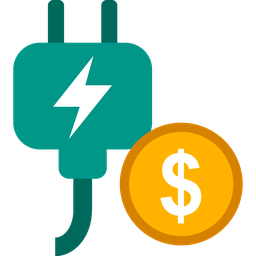

# Plug & Claim



A Home Assistant integration that turns an energy sensor into a monthly
charging claim.

I charge a novated-lease car at home through a smart plug, and every month I
claim the charging cost back. Plug & Claim keeps its own daily kWh ledger for
the plug (separate from the recorder database) and produces the monthly claim
report (XLSX + PDF) for me on the 1st of every month, saved in Home
Assistant's media folder and downloadable from a dashboard card.

It isn't tied to one brand: any `sensor` with the `energy` device class
(kWh) works, so you can use it with other smart plugs or EV chargers.

Requires Home Assistant 2025.2 or newer. It installs two pure-Python
libraries, `openpyxl` (XLSX) and `fpdf2` (PDF), so it runs on any platform,
including Home Assistant OS on ARM.

## Installation (HACS custom repository)

1. In HACS, open the menu (⋮) → **Custom repositories**.
2. Add `https://github.com/psi70y/Plug-and-Claim` with type **Integration**.
3. Install **Plug & Claim** and restart Home Assistant.

Manual install: copy `custom_components/plug_and_claim` into your
`config/custom_components/` folder and restart.

## Setup

**Settings → Devices & services → Add integration → Plug & Claim.**

1. **Choose what to claim:** a name for the claim and the daily energy sensor
   (a sensor that resets every day, like a smart plug's "Today's consumption",
   works best). A power sensor and a monthly energy sensor are optional. If
   you have a TP-Link/Tapo plug, its sensors are filled in for you.
2. **Claim details:** your rate per kWh (AUD, up to 6 decimals), the vehicle
   and registration for the report header, when to generate the report
   automatically, the report folder inside Media, and an optional notify
   action (e.g. `notify.pushover`).

You can change the claim details later with **Configure**. You can add more
than one claim, e.g. one per car or plug.

## How the daily ledger works

Plug & Claim keeps one kWh figure per day in its own file
(`/config/.storage/plug_and_claim.<entry id>`), separate from the recorder
database, so the claim history survives a corrupted or purged database.

- **From long-term statistics (normal case).** If your sensor has a
  `state_class` (smart plugs' "Today's consumption" is `total_increasing`),
  the recorder keeps hourly statistics for it. Plug & Claim adds those up per
  local calendar day, so daylight-saving days are handled correctly.
  - **First start:** it backfills every day the recorder has statistics for.
    The very first day is skipped if the statistics started part-way through it.
  - **Every night at 00:10:** it writes yesterday and re-checks the last
    14 days, which fills gaps after Home Assistant has been off.
  - Days with **no statistics at all** are left out of the ledger and count
    as **0 kWh** in reports. Days with some hours missing count only the
    hours that were recorded (`gap_hours` notes how many were missing).
- **Live capture (fallback).** If the sensor has no statistics, Plug & Claim
  follows its state changes and adds up each day's increase. A warning in the
  log explains this. Days when Home Assistant was off may be incomplete.

Values you set by hand (`set_day`) are never replaced by an automatic sync.

### Small shortfall with daily-reset sensors

A sensor that resets at midnight (like "Today's consumption") is only read
every few seconds, so if the car is charging at midnight the last few seconds
before the reset are never seen. In my case that's 2–3 Wh on a charging night
and about 0.03 kWh a month (around a cent), always slightly under what the
plug's app shows. If you choose the plug's monthly sensor during setup, the
diagnostics show each month's ledger total next to the plug's own month total
so you can see the difference.

## Automatic monthly report

With **Generate the report automatically each month** on, Plug & Claim syncs
and then writes last month's report on the 1st at the time you set (default
01:00), and sends the notification if you set one. If Home Assistant was off
at that time, it catches up when it next starts, during the first 7 days of
the month. A month that already has a report isn't generated again; use the
button or the `generate_report` action to regenerate it.

## Rate changes

When you change the rate under **Configure**, you're asked which month the
new rate applies from (e.g. `2027-01`). Earlier months keep the rate they
had, so their claims and regenerated reports don't change. The form shows
the current rates; entering a rate for a month that already has one replaces
it, which is how you correct a mistake.

## Reports

Each report is an XLSX and a PDF in the same layout as the Tapo app export my
lease provider already knows: a summary row (month, kWh, rate, amount) and one
row per day, including zero days. An optional header block above it shows the
vehicle, registration, period, data source and when it was generated.

- **Saved to:** `<media>/<report folder>/<year>/Energy_Usage_Sep_2026.xlsx`
  and `.pdf`. On Home Assistant OS that's
  `/media/plug_and_claim/ev_charging/2026/`, reachable through the Samba
  share or the File editor. (Home Assistant's Media browser only lists audio,
  video and images, so the reports don't show up there.)
- **Amount** is total kWh × rate, rounded half-up to the cent
  (e.g. 255.303087 × $0.407 = $103.908… → **$103.91**).
- **Days with no data** (e.g. Home Assistant was off all day) count as
  **0 kWh** and show as 0. They're still listed in the diagnostics.
- Generating a month **finalises** it: automatic syncs no longer change it.
  Use `refresh_data: true` to re-read it from the recorder; values you set by
  hand are kept.
- If you set a notify action, you get a message like
  "September 2026 EV charging: 255.30 kWh × $0.407 = $103.91. Report saved to
  /media/plug_and_claim/ev_charging/2026."
- The event `plug_and_claim_report_generated` is fired with `entry_id`,
  `month`, `kwh`, `rate`, `amount` and `files`, so you can build your own
  automations (e.g. email the PDF).

## Dashboard card

Pick a month, see its figures, generate the report and open it.

**Your entity IDs may differ.** Home Assistant builds them from the device
name, and on recent versions also from the device's area, e.g. a claim called
"EV charging" in the area "Shed" gets `sensor.shed_ev_charging_…`. To list
yours, paste this into **Developer tools → Template**:

```jinja

{{ e }}

```

Then replace the IDs below with yours. To add it to a dashboard, edit the
dashboard, choose **+ Add card → Manual** (at the bottom of the list) and
paste:

```yaml
type: vertical-stack
cards:
  - type: entities
    title: EV charging claim
    entities:
      - entity: select.ev_charging_report_month
        name: Month
      - entity: sensor.ev_charging_selected_month_energy
        name: Energy
      - entity: sensor.ev_charging_selected_month_claim
        name: Claim
      - entity: button.ev_charging_generate_report_for_selected_month
        name: Generate report
      - type: divider
      - entity: sensor.ev_charging_this_month_energy
        name: This month so far
      - entity: sensor.ev_charging_this_month_estimated_claim
        name: This month's estimated claim
  - type: markdown
    content: >-
      
      
      <a href="{{ state_attr(s, 'pdf_url') }}" target="_blank">📄 Open PDF</a> ·
      <a href="{{ state_attr(s, 'xlsx_url') }}" target="_blank">📊 Download XLSX</a>
      <br><small>Generated {{ as_timestamp(state_attr(s, 'report_generated')) | timestamp_custom('%d %b %Y %H:%M') }}</small>
      
      No report yet for {{ state_attr(s, 'month') }}. Press **Generate report**.
      
```

If you'd rather paste it into a view's **Raw configuration editor**, wrap it
in a view, because that editor expects a whole view rather than one card:

```yaml
title: EV charging
path: ev-charging
type: masonry
cards:
  - type: vertical-stack
    cards:
      # ...the two cards above, indented to this level
```

The links are signed, so they work without logging in again, but they
expire after 24 hours and whenever Home Assistant restarts. The card always
shows fresh ones. Don't copy them anywhere permanent. They're also kept out
of Home Assistant's history.

## Entities

| Entity | Notes |
| --- | --- |
| This month energy | kWh so far this month, including today (updated every 5 minutes). |
| This month estimated claim | This month's kWh × rate, in AUD. |
| Last month energy / Last month claim | Last month's totals, the same figures the report uses. |
| Report month | Select a finished month, e.g. "2026-09 (Sep 2026)". Remembered across restarts. |
| Selected month energy / Selected month claim | Totals for the month in Report month. Attributes: rate, days with data, missing days, report files, when the report was generated, and signed `pdf_url` / `xlsx_url` download links once a report exists. |
| Generate report for selected month | Button. Writes the report for the month in Report month. |
| Sync now | Diagnostic button. Re-reads the last 14 days from the recorder. |
| Last sync | Diagnostic. When the ledger was last updated. |
| Ledger days | Diagnostic. Number of days in the ledger; attributes show the capture mode and first/last day. |

The month sensors also have `month`, `rate`, `day_count` and `missing_days`
attributes (days with no data, which count as 0 kWh).

## Actions

| Action | What it does |
| --- | --- |
| `plug_and_claim.sync` | Re-reads the last `days_back` days (default 14) from the recorder. Call it with a response to see which days changed. |
| `plug_and_claim.set_day` | Sets one past day's kWh by hand, e.g. to fill a gap. |
| `plug_and_claim.generate_report` | Writes the report for a finished `month` (`YYYY-MM`). Optional `refresh_data` and `notify`. Call it with a response to get the totals and file paths. |

Example (Developer tools → Actions, with **Return response** ticked):

```yaml
action: plug_and_claim.sync
data:
  config_entry_id: <your claim>
  days_back: 45
```

```yaml
action: plug_and_claim.generate_report
data:
  config_entry_id: <your claim>
  month: "2026-09"
```

## Email the report

The `plug_and_claim_report_generated` event carries the file paths, so an
automation can email the PDF. With an email (SMTP) notifier set up, for
example as `notify.email`:

```yaml
alias: Email the EV charging claim
triggers:
  - trigger: event
    event_type: plug_and_claim_report_generated
actions:
  - action: notify.email
    data:
      title: "EV charging claim {{ trigger.event.data.month }}"
      message: >-
        {{ trigger.event.data.kwh | round(2) }} kWh ×
        ${{ trigger.event.data.rate }} = ${{ '%.2f' | format(trigger.event.data.amount) }}
      data:
        images: "{{ trigger.event.data.files | select('search', 'pdf$') | list }}"
```

The SMTP notifier's `images` field attaches other file types too (it logs a
harmless warning that the PDF isn't an image). The media folder is allowed
by default; if you changed `allowlist_external_dirs`, make sure it's included.

## Limitations

- **Reports don't show in the Media browser.** Home Assistant's Media browser
  only lists audio, video and images. Use the dashboard card's download links,
  the Samba share or the File editor.
- **Daily-reset sensors run slightly low** (a few Wh per night of charging
  across midnight, see above), and **days when Home Assistant was off count as
  0 kWh**. Both mean the claim errs slightly in the lender's favour.
- **Currency is AUD** and the layout follows the Tapo app's export.
- **One energy sensor per claim.** Add a second claim for a second car or plug.
- **Deleting a claim keeps its ledger file** in `/config/.storage` in case
  that was a mistake. A new claim starts a new ledger.

## Diagnostics

**Settings → Devices & services → Plug & Claim → ⋮ → Download diagnostics**
gives the settings, per-month totals (with the plug's own month total and the
difference, if you chose a monthly sensor) and the last 31 days of the ledger.

## License

MIT
